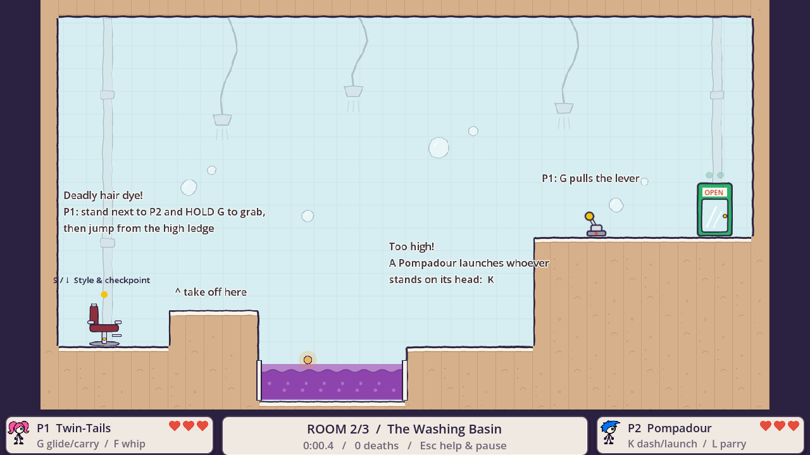
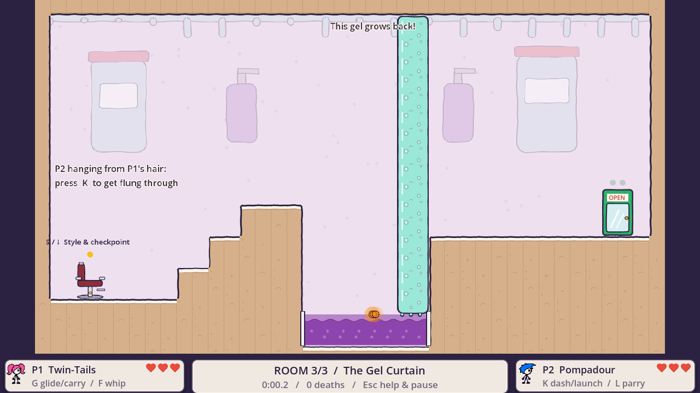
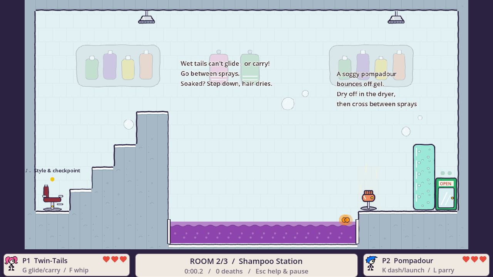

# Difficulty report (generated)

> `python -I tools/difficulty/report.py` rebuilds this page; see the bottom for how to read it.

## 1. Margins: how much room to spare

Every gap and height a room asks for, against the move's reach measured just now in an
empty arena (tiles). *tight* < 1 tile, *fair* < 2, *roomy* otherwise.

| Level | Room | Obstacle | Move | Needs | Reaches | Spare | |
|---|---|---|---|---|---|---|---|
| level_01 | 1 - Mirror, Mirror | 10-wide pit to the lever | glide | 10 | 12.2 | +2.2 | roomy |
| level_01 | 2 - The Washing Basin | 8-wide dye pool, both friends | carry | 8 | 11.2 | +3.2 | roomy |
| level_01 | 2 - The Washing Basin | 6-up cliff | launch | 6 | 9.1 | +3.1 | roomy |
| level_03 | 2 - Shampoo Station | 17-wide dye pool from 9 up, both friends | carry | 17 | 20.1 | +3.1 | roomy |
| level_03 | 3 - Rinse & Repeat | 18-wide dye pool from 12 up under a shower, both friends | carry | 18 | 23.9 | +5.9 | roomy |
| level_04 | 1 - The Perm Rollers | Roller shelf 11 up | spring | 11 | 11.7 | +0.7 | tight |
| level_05 | 1 - Extension Bar | Friend up the bar | rope | 9 | 10.0 | +1.0 | fair |
| level_05 | 2 - The Up-Do | 21-wide dye pool from 13 up, both friends | carry | 21 | 25.2 | +4.2 | roomy |
| level_05 | 3 - Tangles | Friend up the ledge | rope | 9 | 10.0 | +1.0 | fair |
| level_05 | 3 - Tangles | 18-wide dye pool from 9 up, both friends | carry | 18 | 20.1 | +2.1 | roomy |
| level_05 | 3 - Tangles | Gate lever 5 up | lasso_lever | 5 | 6.2 | +1.2 | fair |
| level_06 | 1 - Closing Time | 9-wide dye pool, both friends | carry | 9 | 11.2 | +2.2 | roomy |
| level_06 | 2 - The Chair | 6-up cliff | launch | 6 | 9.1 | +3.1 | roomy |
| level_06 | 4 - The Barber Bot | Corner ledge 7 up, above the knob | launch | 7 | 9.1 | +2.1 | roomy |
| level_06 | 4 - The Barber Bot | Corner ledge 7 up, above the knob | spring | 7 | 11.7 | +4.7 | roomy |
| level_06 | 4 - The Barber Bot | Corner ledge 7 up, above the knob | hook | 7 | 9.4 | +2.4 | roomy |
| style_lab | 2 - Rapunzel Crossing | 17-wide dye pool | rope_glide | 17 | 33.2 | +16.2 | roomy |
| style_lab | 3 - Tony's Makeover | Corner ledge 7 up, above the knob | launch | 7 | 9.1 | +2.1 | roomy |
| style_lab | 3 - Tony's Makeover | Corner ledge 7 up, above the knob | spring | 7 | 11.7 | +4.7 | roomy |
| style_lab | 3 - Tony's Makeover | Corner ledge 7 up, above the knob | hook | 7 | 9.4 | +2.4 | roomy |

Measured reach: `carry_reach_12` 23.89, `carry_reach_13` 25.2, `carry_reach_2` 11.2, `carry_reach_9` 20.1, `glide_reach_0` 12.22, `glide_reach_9` 33.22, `launch_rise` 9.12, `spring_rise_min` 11.66

## 2. Sloppy players: does it survive a person's timing?

Each level's playthrough bot, rerun with 130-330 ms reactions, aim off by up to
6 px and button holds 25 % too long or short. Clean = every check passed.

| Level | Clean runs | Most common first failure |
|---|---|---|
| level_01 | 7/12 | R3: twin-tails grabs pompadour on the counter (4x); R2: twin-tails grabs pompadour (1x) |
| level_02 | 5/12 | R2: hair catch from the far trench rings the second bell (3x); R2: both in the exit clears L2 (2x); R1: both climb the shelves to the door (2x) |
| level_03 | 6/12 | R2: dry pompadour smashes the gel (5x); flying into the running shower soaks P1 and drops the carry into the dye (1x) |
| level_04 | 10/12 | R2: the cannonball punches the pompadour through the perm-set gel (1x); Perm Day clear: the results open (1x) |
| level_05 | 4/12 | R1: Long Straight hooks the ring onto the bar (5x); Extensions clear: the results open (1x); R3: Long Straight lassos the gate lever (1x) |
| level_06 | 4/12 | R1: twin-tails grabs pompadour on the ledge (3x); standing in its path still gets you hit (3x); R1: pompadour's dash takes out the clipper bot (1x) |

## 3. Play log: where people (and sloppy bots) die, and how long rooms take

| Source | Level | Room | Sessions | Starts | Clears | Deaths | Median time (s) | Top causes |
|---|---|---|---|---|---|---|---|---|
| bot-sloppy | level_01 | 1 - Mirror, Mirror | 12 | 12 | 12 | 0 | 10.7 | - |
| bot-sloppy | level_01 | 2 - The Washing Basin | 12 | 12 | 11 | 1 | 9.8 | DyePool 1 |
| bot-sloppy | level_01 | 3 - The Gel Curtain | 11 | 11 | 7 | 4 | 10.9 | DyePool 4 |
| bot-sloppy | level_02 | 1 - Return to Sender | 12 | 12 | 10 | 2 | 29.0 | Scissor 2 |
| bot-sloppy | level_02 | 2 - Scissor Corridor | 10 | 10 | 5 | 3 | 42.3 | Scissor 3 |
| bot-sloppy | level_03 | 1 - Blow-Dry Bar | 12 | 12 | 12 | 0 | 12.6 | - |
| bot-sloppy | level_03 | 2 - Shampoo Station | 12 | 12 | 7 | 5 | 20.2 | DyePool 5 |
| bot-sloppy | level_03 | 3 - Rinse & Repeat | 7 | 7 | 7 | 0 | 10.5 | - |
| bot-sloppy | level_04 | 1 - The Perm Rollers | 12 | 12 | 12 | 0 | 17.3 | - |
| bot-sloppy | level_04 | 2 - Setting Lotion | 12 | 12 | 11 | 0 | 13.9 | - |
| bot-sloppy | level_04 | 3 - Double Return | 11 | 11 | 11 | 0 | 13.8 | - |
| bot-sloppy | level_05 | 1 - Extension Bar | 12 | 12 | 7 | 0 | 10.2 | - |
| bot-sloppy | level_05 | 2 - The Up-Do | 7 | 7 | 7 | 0 | 8.8 | - |
| bot-sloppy | level_05 | 3 - Tangles | 7 | 7 | 5 | 2 | 15.8 | ClipperBot 1, DyePool 1 |
| bot-sloppy | level_06 | 1 - Closing Time | 12 | 12 | 8 | 4 | 29.4 | DyePool 3, ClipperBot 1 |
| bot-sloppy | level_06 | 2 - The Chair | 8 | 8 | 8 | 0 | 23.1 | - |
| bot-sloppy | level_06 | 3 - Rush Hour | 8 | 8 | 7 | 1 | 23.0 | Scissor 1 |
| bot-sloppy | level_06 | 4 - The Barber Bot | 7 | 7 | 7 | 0 | 12.1 | - |
| human | level_01 | 1 - Mirror, Mirror | 2 | 4 | 0 | 0 | - | - |
| human | level_01 | 3 - The Gel Curtain | 2 | 0 | 2 | 0 | - | - |
| human | level_02 | 1 - Return to Sender | 2 | 8 | 0 | 0 | - | - |
| human | level_03 | 1 - Blow-Dry Bar | 2 | 8 | 0 | 0 | - | - |
| human | level_04 | 1 - The Perm Rollers | 2 | 2 | 0 | 0 | - | - |
| human | level_05 | 1 - Extension Bar | 2 | 2 | 0 | 0 | - | - |
| human | level_06 | 1 - Closing Time | 2 | 4 | 0 | 0 | - | - |
| human | level_06 | 4 - The Barber Bot | 2 | 0 | 2 | 0 | - | - |

### Death heatmaps

Red dots: people. Orange dots: sloppy bots.

**level_01_R2**

**level_01_R3**

**level_02_R1**

**level_02_R2**

**level_03_R2**

**level_05_R3**

**level_06_R1**

**level_06_R3**

## How to read it

- **Margins** catch layout that is too tight (or impossible) for a move, with no play at all.
- **Sloppy runs** catch steps that need near-perfect timing: a step that fails for a
  bot with human reaction times will fail for a lot of people. A failure can also be the
  bot's own script being brittle; the first-failure label says which step to look at.
- **The play log** is the only part that says anything about people. It records by
  itself on every playthrough (local files only), so short sessions from friends add up.
- None of this measures *fun*. Use it to find the rooms worth watching someone play.
