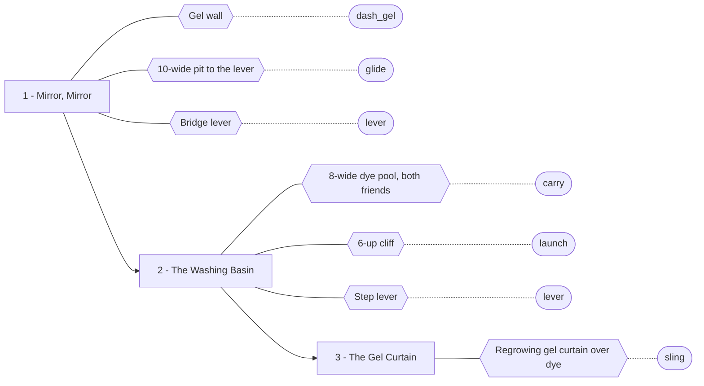
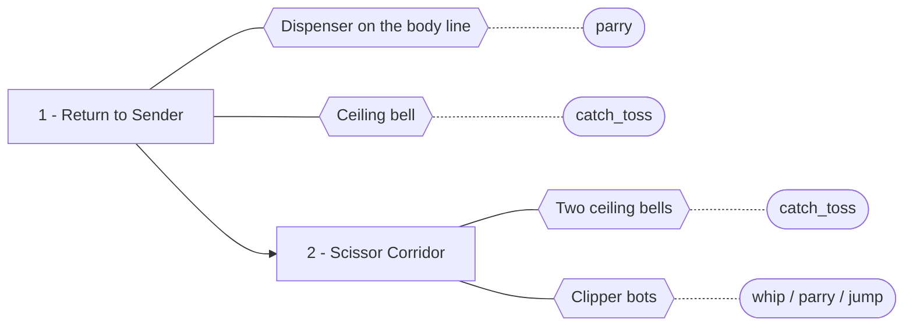
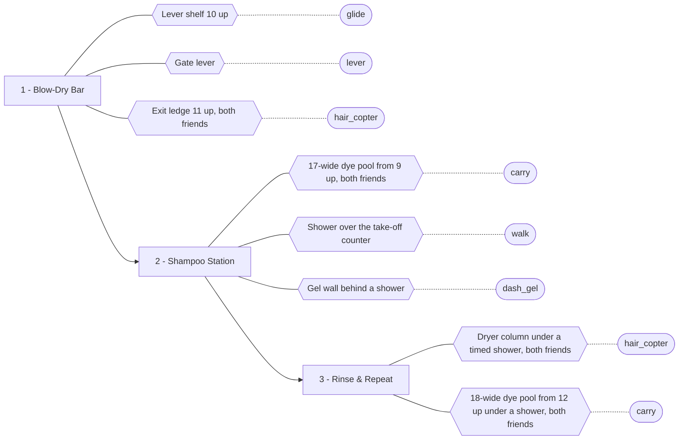
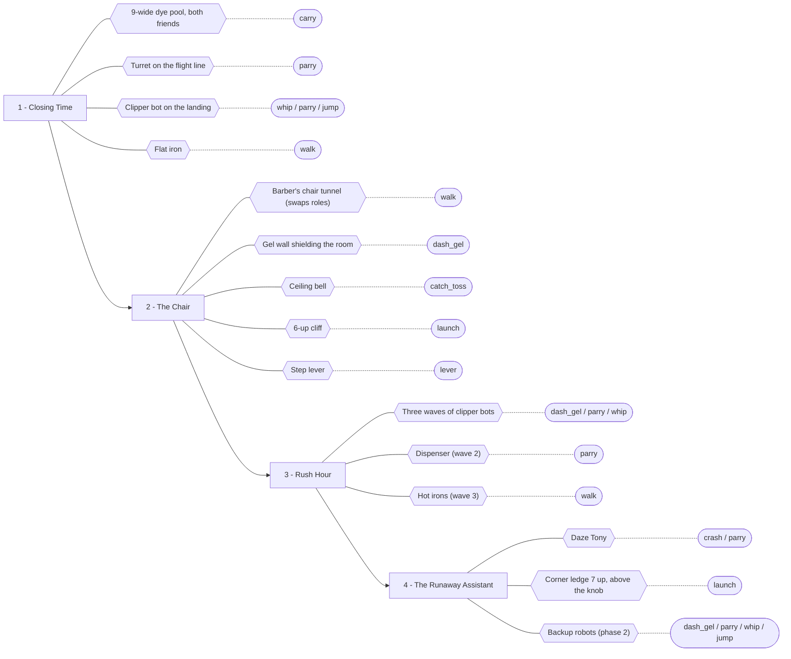

# Gate graph (generated)

> Generated by `tools/gate_graph.gd` from the built level scenes: don't edit by hand.
> Each room lists its obstacles (gates) and the verbs that get past each one; every
> haircut pair the room allows must have a verb for every gate (`tests/test_gates.gd`).
> Rules and verbs: `scenes/systems/style_rules.gd`; design: `docs/design/story_escape.md`.

## Chapter 1: Fresh Cut

| Room | Starts as (P1 / P2) | Chair offers | Pairs checked |
|---|---|---|---|
| 1 - Mirror, Mirror | Twin-Tails / Pompadour | Twin-Tails, Pompadour | 1 |
| 2 - The Washing Basin | Twin-Tails / Pompadour | Twin-Tails, Pompadour | 1 |
| 3 - The Gel Curtain | Twin-Tails / Pompadour | Twin-Tails, Pompadour | 1 |

## Chapter 2: Return to Sender

| Room | Starts as (P1 / P2) | Chair offers | Pairs checked |
|---|---|---|---|
| 1 - Return to Sender | Twin-Tails / Pompadour | Twin-Tails, Pompadour | 1 |
| 2 - Scissor Corridor | Twin-Tails / Pompadour | Twin-Tails, Pompadour | 1 |

## Chapter 3: Wash & Blow-Dry

| Room | Starts as (P1 / P2) | Chair offers | Pairs checked |
|---|---|---|---|
| 1 - Blow-Dry Bar | Twin-Tails / Pompadour | Twin-Tails, Pompadour | 1 |
| 2 - Shampoo Station | Twin-Tails / Pompadour | Twin-Tails, Pompadour | 1 |
| 3 - Rinse & Repeat | Twin-Tails / Pompadour | Twin-Tails, Pompadour | 1 |

## Chapter 4: The Assistant

| Room | Starts as (P1 / P2) | Chair offers | Pairs checked |
|---|---|---|---|
| 1 - Closing Time | Twin-Tails / Pompadour | Twin-Tails, Pompadour | 1 |
| 2 - The Chair | Twin-Tails / Pompadour | Twin-Tails, Pompadour | 1 |
| 3 - Rush Hour | Pompadour / Twin-Tails | Pompadour, Twin-Tails | 1 |
| 4 - The Runaway Assistant | Pompadour / Twin-Tails | Twin-Tails, Pompadour | 1 |

## Verbs

| Verb | Meaning | Who |
|---|---|---|
| `walk` | walk / take a timing window | anyone |
| `jump` | jump (3.5 tiles up, 6 across) | anyone |
| `crash` | bait a charge into a wall | anyone |
| `glide` | glide (12.5 tiles flat) | Twin-Tails |
| `carry` | carry a friend (8.9 flat, 16.5 from 6 up) | Twin-Tails |
| `lever` | pull a lever by hand | Twin-Tails |
| `whip` | whip-stun a bot | Twin-Tails |
| `hair_copter` | ride a glider up a dryer | Twin-Tails |
| `dash_gel` | dash through gel | Pompadour |
| `parry` | parry a scissor | Pompadour |
| `launch` | launch a rider (9 tiles) | Pompadour |
| `sling` | sling dash through regrowing gel | Twin-Tails + Pompadour |
| `catch_toss` | catch a parried scissor, toss it up | Twin-Tails + Pompadour |
